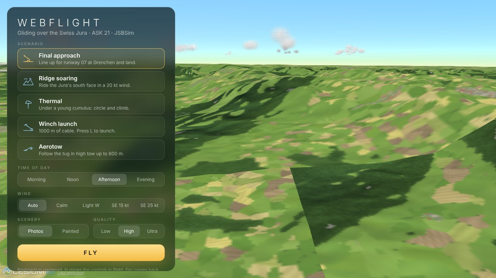
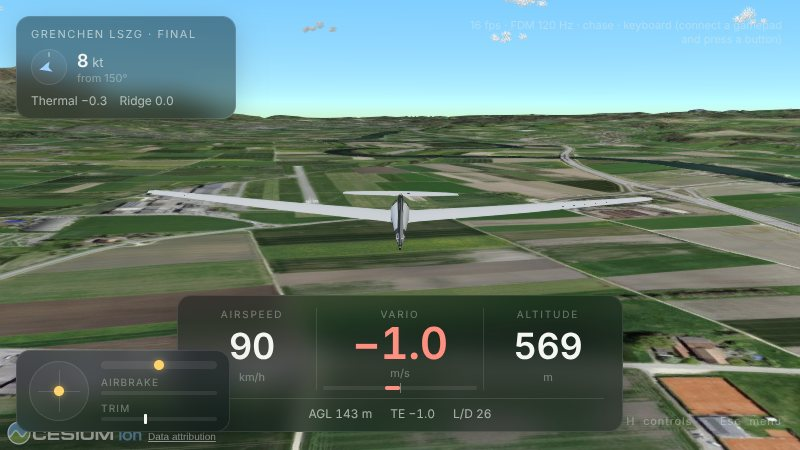
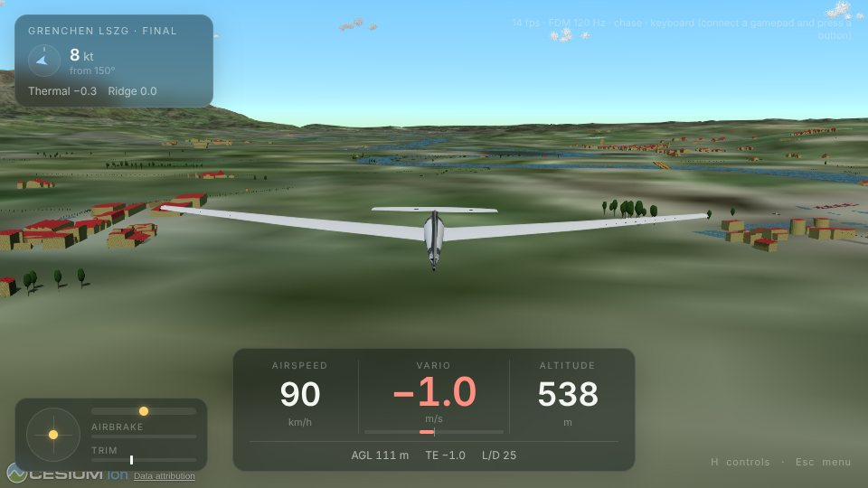
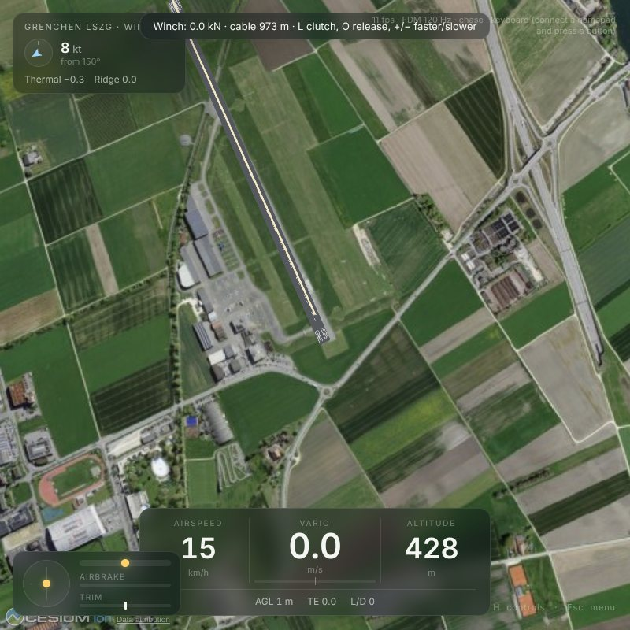
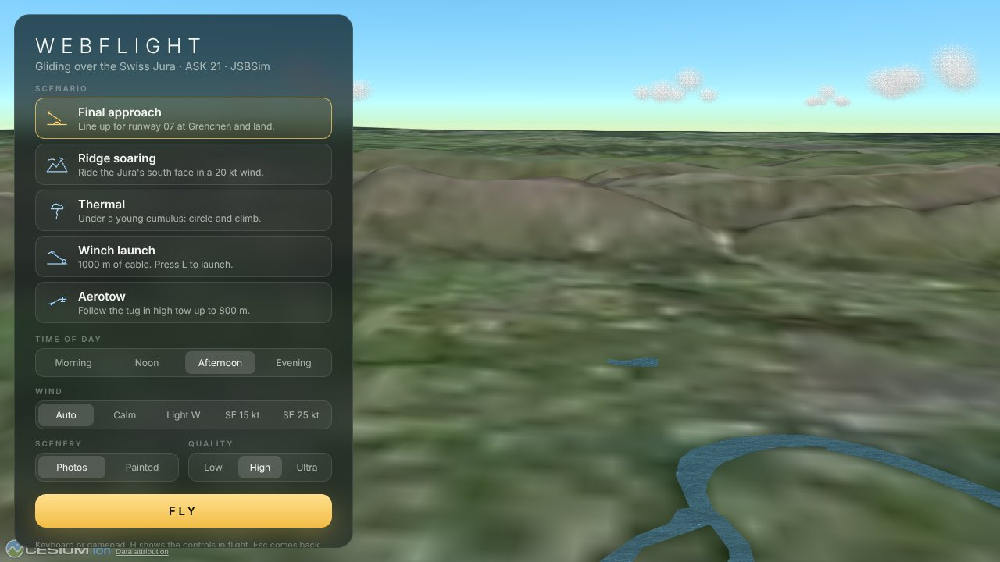

# Look and feel

| Title screen | Ridge soaring |
|---|---|
|  |  |

These screenshots were taken in a cloud container whose network blocks the photo servers and which renders in software (SwiftShader, about 15 fps). They therefore show the **painted fallback** with tiles still streaming in. In a normal browser you get aerial photos and sharp tiles.

## What's there

| Piece | Where | Notes |
|---|---|---|
| Title screen | `web/src/menu.ts` | A slow orbit over Grenchen and the Jura under the day's cumulus. Scenario cards (final approach, ridge, thermal, winch, aerotow). Time of day, wind, scenery and quality. Choices are remembered (localStorage), and Enter flies. Everything ends up in URL parameters, so any flight can be bookmarked. An empty URL or `?menu` shows the menu; **Esc** in flight returns to it. |
| Imagery | `web/src/imagery.ts` | **Photos**: swisstopo SWISSIMAGE over Switzerland on top of Sentinel-2 cloudless (2016, CC BY 4.0) elsewhere. A quick probe checks the servers. If they can't be reached, the app uses the **painted** terrain instead. The real runway is visible in the photos, so the drawn runway is added only for the other modes. |
| Painted terrain | `web/src/paint/` | Land cover generated from the Terrarium heights in workers. Fields and hedgerows on flat lowland, forest on slopes and in patches, villages, ridge pastures, alpine meadow, rock, scree and snow, all hillshaded from the actual sun position. The noise works in a fixed metric frame, so features are continuous across tiles and zoom levels. Tiles copy Terrarium pixels directly (`TerrariumTerrain.heightGrid`): about 45 ms per 256² tile in Node. |
| Light | `web/src/scene.ts`, `sun.ts` | Sun position for mid-July at the chosen time (`morning` 07:15, `noon`, `afternoon` 16:30, `evening` 20:50 CEST, or `HH:MM`). Sun-lit globe with dynamic atmosphere, haze and fog. Soft glider shadow on the ground. FXAA. |
| Clouds | `web/src/scene.ts` | A cumulus over each thermal, from Cesium's procedural cloud impostors: a few puffs with a flat base at the thermal's cloud base. They grow while the thermal forms and fade as it dies, so the clouds mark the lift as real ones do. |
| HUD | `web/src/hud.ts`, `style.css` | Frosted-glass panels. A bottom instrument strip (airspeed, a large colour-coded vario with a bar, altitude; AGL, TE, L/D). Wind arrow relative to the nose, with thermal and ridge lift. Stick, rudder, airbrake and trim indicators. Launch status, pilot messages, a pause banner and a help card (**H**). |
| Loading | `index.html`, `style.css` | A quiet title card with a progress shimmer while the aircraft and FDM load. |

## Quality presets (`quality=`)

- `low`: no shadows.
- `high` (default): soft shadows and FXAA.
- `ultra`: adds HDR and 4× MSAA. Under SwiftShader, MSAA alone, and HDR together with shadows, rendered the globe incorrectly (black ground, inverted haze). Real GPUs are expected to be fine, but this isn't verified, so `ultra` is opt-in.

## Fixed along the way

- **Terrain cliffs at tile edges.** `TerrariumTerrain.heightmap()` sampled through the shared tile cache after awaiting its loads. Concurrent requests evicted those tiles in between, so some heights read 0 m, which showed up as walls along tile edges. It now samples from the tile arrays it loaded. Coarse levels went from up to −645 m mean error to about 1 m.
- **Coarse terrain flattened the ridges.** Terrain tiles are now 65×65 samples instead of 33×33.

## Scenery

| Final at Grenchen (photos) | Buildings, trees, river |
|---|---|
|  |  |
| **Runway from above (swisstopo photo)** | **The Aare from the title screen** |
|  |  |

These were taken in the cloud container, which renders in software at about 15 fps. Tiles there need 1–3 minutes to sharpen, so several shots are still blurry. A GPU loads them quickly.

| Layer | Source (open data, no key) | Notes |
|---|---|---|
| Aerial photos | swisstopo SWISSIMAGE to zoom 20 (≈ 10 cm), Sentinel-2 cloudless outside | Real fields, roads, villages, the airfield. |
| Buildings | swisstopo swissTLM3D as 3D Tiles (`vectortiles0.geo.admin.ch/3d-tiles/ch.swisstopo.swisstlm3d.3d`) | Real footprints and roof shapes. Tinted pale walls and red roofs. Cast shadows. |
| Trees | swisstopo vegetation 3D Tiles (`ch.swisstopo.vegetation.3d`) | Every surveyed tree as an instance of five tree models. Detail 24 (12 on `ultra`): the full set at fine detail stalled a software renderer. |
| Water | swisstopo base vector tiles (`ch.swisstopo.base.vt`, layer `water`) | Lakes and rivers from zoom-11 tiles (±30 km), ponds and pools from zoom-14 tiles around the glider. Animated water material on the terrain. Decoded by our own MVT decoder (`packages/scenery`, no dependency). |
| Runway | swisstopo base vector tiles, layer `aeroway` | Grenchen's site constant comes from the runway polygon. Before this it was 9 m and 1.4° off, visible against the photos. |

**Heights.** swisstopo's 3D Tiles use the same sea-level heights we use for terrain, so no geoid shift is needed. Checked on the Grenchen tiles: building bases sit 1.9 m below our ground (median), and tree bases 1.0 m above it.

**Loading order.** The 3D scenery starts once the globe's terrain and imagery have loaded (or after 20 s), because the tilesets otherwise starve the ground of requests and CPU. The terrain itself now uses the Web Mercator tiling of Terrarium and of all imagery, so imagery drapes without GPU reprojection. The renderer's terrain is preloaded around the start at zooms 8–13 in parallel.

**Turning layers off.** `buildings=0`, `trees=0` and `water=0` turn layers off. `quality=low` drops buildings, trees and shadows.

### Still to do

- The painted fallback could use the same vector data (forest, water, roads, buildings) instead of noise.
- Scenery outside Switzerland: OSM buildings, trees and water (Overpass wasn't reachable from the container).
- swissALTI3D (0.5–2 m) terrain for rendering only, close to the ground.
- Close-up detail textures (grass, asphalt), and a runway with markings in photo mode.
