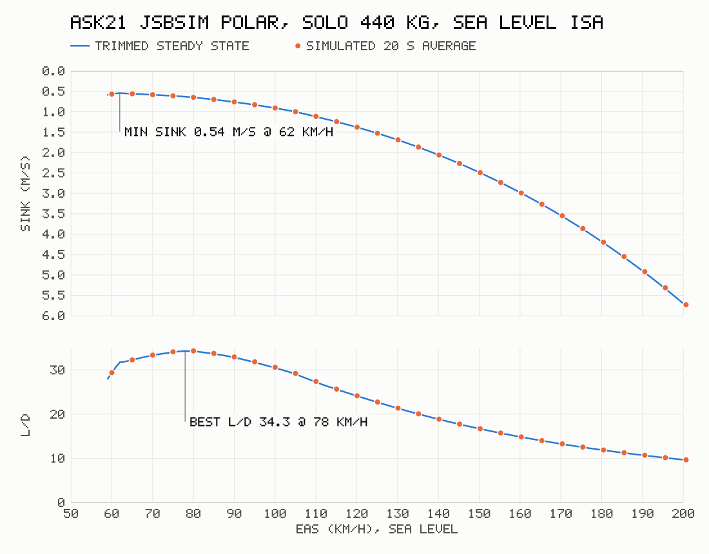

# Milestone 1: physics proof (ASK21, JSBSim WASM, Node)

Aircraft: FGAddon `Aircraft/ASK21`, `ask21-jsb-set.xml` → JSBSim model `ask21-jsb`
(aero in `Systems/ask21-aero.xml`, FCS in `Systems/ask21-fcs.xml`).
Loadout: solo, one 80 kg pilot; copilot pointmass set to 0. Total mass 440 kg
(360 kg empty in the FDM). JSBSim 1.2.4 via `@0x62/jsbsim-wasm@1.2.4-beta.4`, 120 Hz,
ISA, still air, rotating Earth, start at 47° N 8° E, heading north.

## Results (`pnpm glide`, `pnpm polar`)

Speed polar, reduced to sea level (EAS, sink × √σ), trimmed steady states at 1 km/h steps:

| | Value |
|---|---|
| Best L/D | **34.3 at 78 km/h EAS** (sink 0.63 m/s) |
| Min sink | **0.54 m/s at 62 km/h EAS** |
| Lowest steady speed | 59 km/h EAS (CLmax 1.507 at α = 12° in the lift table) |

The time-domain check flies each 5 km/h point for 25 s from its trim. Its sink
agrees with the trimmed value within 0.03 m/s, and speed drifts by at most 0.8 km/h.

120 s glide from 1000 m AGL at 78 km/h EAS, stick neutral after trim: 80.3 m lost,
glide ratio 33.9, mean pitch +1.7°. It takes about 0.2 s of wall time.

## Findings that affect later milestones

1. **JSBSim's built-in trim does not work for gliders.** `tLongitudinal`/`tFull` trim
   u-dot with the throttle and fail with "udot doesn't appear to be trimmable".
   `fdm-core/trimSteadyGlide` treats the flight-path angle as a free variable instead.
   It solves udot = wdot = qdot = 0 for (α, γ, pitch trim) by Newton's method on
   JSBSim's own derivatives (RunIC with the FCS in trim mode) and converges in about 3
   iterations. With this trim no speed-hold PID is needed.
2. **FlightGear-owned properties must be created by the host.** The ASK21 FCS reads
   `/controls/engines/engine/throttle` (the airbrake lever, inverted: 1 = closed) and
   `/systems/groundhandling/*`. Standalone JSBSim throws at the first RunIC if they
   don't exist. If they default to 0, the airbrakes are fully out and L/D drops to about 4.
   The converter now finds every absolute property the JSBSim XML reads and takes its
   default from the `-set.xml` property tree, includes resolved. The web input mapping
   must drive the airbrake through that throttle property.
3. **C++ exceptions reach JS as bare numbers.** `Fdm` turns them into `FdmError`
   with the last JSBSim log lines.
4. **Spiral mode.** With controls neutral, Coriolis acceleration (rotating Earth,
   ~0.008 ft/s² sideways at trim) seeds the model's unstable spiral mode, which doubles
   in about 15 s. After 120 s the glider has 2.7° of bank and has turned 22°, which
   costs a little L/D at the end. This is how the FDM behaves; the polar is unaffected.
   The RL observation and the browser HUD should expect it.
5. `position/terrain-elevation-asl-ft` is stored as a radius, so a written value
   reads back with an error of about 1e-9 ft.
