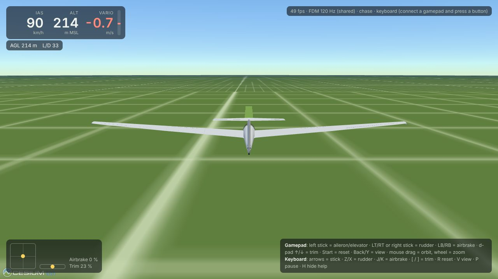
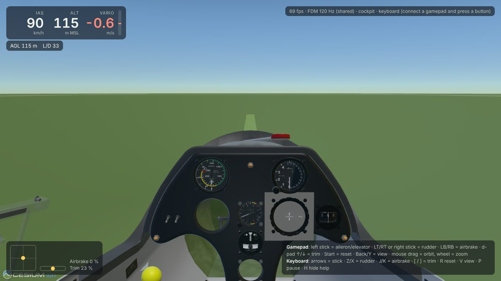
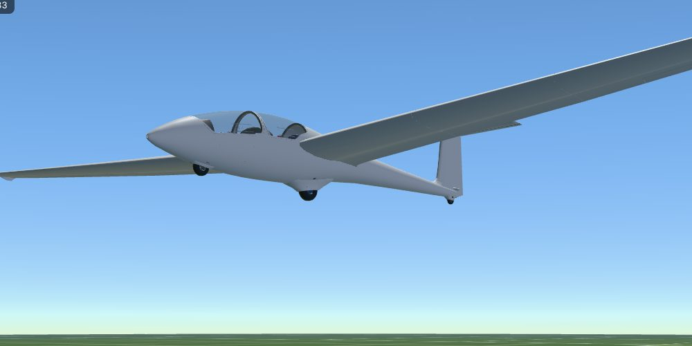

# Milestone 2: it flies in the browser

```sh
pnpm install
pnpm bundle:ask21   # fetches ASK21 if needed, writes apps/web/bundles/ASK21 (git-ignored)
pnpm dev            # http://localhost:5173
```

URL options: `?view=cockpit`, `?agl=220&dist=2500&eas=90` (start height, distance south of
the strip, speed), `?map=osm` (OpenStreetMap imagery instead of the grid), `?nosab=1`
(force the postMessage snapshot path).




## How it fits together

| Piece | Where | Notes |
|---|---|---|
| Converter v1 | `packages/converter` (`bundle.ts`, `fgmodel.ts`, `ac3d.ts`, `glb.ts`) | TypeScript AC3D→glTF instead of Blender: no external tool, deterministic, and keeps FG node names and frames. 54 model files → 441 objects, 160k triangles, 10.8 MB GLB, 1.5 s. |
| Animation manifest | `manifest.json` → `model.animations` | rotate, translate, spin, select, named groups, with SimGear conditions. Centres and axes are in glTF coordinates. |
| FDM worker | `apps/web/src/fdm-worker.ts` | JSBSim WASM in a module worker at a fixed 120 Hz, driven by wall-clock time (catch-up capped at 0.25 s). |
| Snapshot | `fdm-core/snapshot.ts` | Seqlocked Float64 SharedArrayBuffer when cross-origin isolated (COOP `same-origin`, COEP `credentialless`), otherwise postMessage. |
| Pose | `fdm-core/pose.ts` | Model origin at JSBSim's VRP, attitude in JSBSim's geodetic NED frame, WGS84 ECEF (the same frame Cesium uses). |
| FG conventions | `fdm-core/fg-bridge.ts` | Copied from FlightGear's `JSBSim.cxx`: rudder sign flips, `/surface-positions/*`, gear outputs. |
| Renderer | `apps/web/src/{scene,aircraft,camera,hud,input}.ts` | Cesium on the ellipsoid with a grid for motion cues and a grass strip at 47°N 8°E. |
| Terrain feedback | `scene.ts` `TerrainSampler` | Writes `position/terrain-elevation-asl-ft`. See finding 3. |

## Verification

- `pnpm test` runs 34 tests. The ones added in this milestone cover:
  - pose math (nose, up and right wing land on N, Up, E; VRP offset);
  - snapshot round trip;
  - animation semantics (value composition, conditions, order, held values, spin);
  - converter output (baked AC transforms, axis from two points or a line object, nested named groups, submodel offsets, GLB structure);
  - the ASK21 bundle loaded through the worker's reader;
  - flared and firm headless landings: no bounce, CG never below its resting height by more than 5 cm, glider stops;
  - FG control signs checked against the FDM.
- `node apps/web/scripts/smoke.cjs` drives a running dev server in headless Chromium and
  checks cross-origin isolation, FDM rate 110–130 Hz, a hands-off touchdown with the main
  wheel staying down, and no page errors. Last run: 120 Hz, no bounce, minimum CG height
  0.677 m after touchdown (resting height 0.667 m).
- Checked by hand in headless Chromium with software WebGL:
  - 50–58 fps;
  - surfaces move the right way (aileron 0.6 → 14.4°, airbrakes 0.11 m);
  - wheels sit on the ground after landing;
  - production build (`pnpm build`, `vite preview`) boots in 2.5 s;
  - a fake standard-mapping gamepad drives the right properties.

  A real gamepad has not been tested here.



## Findings

1. **Worker scripts need COEP too.** In a cross-origin-isolated page, Cesium's workers were
   blocked (`ERR_BLOCKED_BY_RESPONSE`) until the static middleware sent COOP/COEP itself.
2. **Named animation groups must be created in place.** SimGear puts a named group where its
   first object was. Grouping at the model root pulled the ASK21mi propeller out of the
   `variant == 1` select, so it showed on the pure glider.
3. **`globe.getHeight()` is unsafe for physics.** It reads whatever tiles are loaded, and at
   startup coarse tiles are kilometres below the ellipsoid. That put JSBSim's ground 48 km
   down for a few seconds. `TerrainSampler` queries the provider's most detailed level in
   the background instead (exactly 0 on the ellipsoid) and sends nothing until it has an
   accurate value. This matters again for real terrain in Milestone 4.
4. **Vite's public-dir cache** stops serving a folder that is deleted and recreated, so
   bundles are served from `apps/web/bundles` by the raw middleware instead of `public/`.
5. **JSBSim at rest:** the ASK21 sits on its nose and main wheels after landing and then
   slowly tips onto a wing skid, as a real single-wheel glider does.

## Known gaps (later milestones)

- Panel instruments and the wool threads come from FlightGear's shared `Aircraft/Instruments-3d`
  data, which isn't in the aircraft folder, so they're missing.
- Skipped animation types (pick, knob, slider, material, texture transforms) and
  `<expression>` values are Milestone 3. Wing flex is Milestone 3 too: it is driven by a
  FlightGear property rule, so the wings render rigid.
- The JSBSim WASM is shipped twice in production builds (1.7 MB extra), because `fdm-core`
  also references the package's default URLs.
- The renderer shows the latest FDM state without interpolating between steps. That is
  fine at 120 Hz vs 60 fps; revisit if jitter is visible on high-refresh displays.
