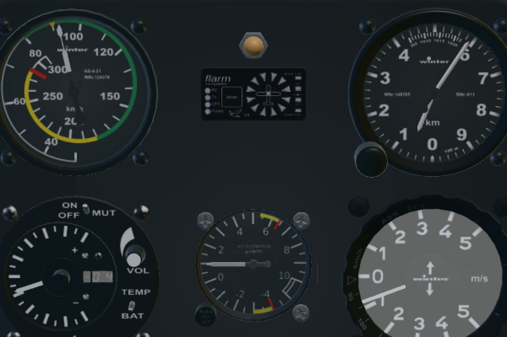

# Milestone 3: animation interpreter, cockpit gauges, Nasal in TypeScript

```sh
pnpm bundle:ask21   # also fetches the FGData files the aircraft uses
pnpm dev            # V = cockpit view; click switches, wheel on knobs, drag to look, wheel to zoom
```



## What runs where

FlightGear aircraft depend on much more than the FDM: instruments are C++ subsystems fed by
pitot/static systems, property rules turn their outputs into what needles read, and Nasal
glues the rest together. Milestone 3 adds those pieces as a browser-free package that runs
next to the FDM, so the headless trainer gets the same instruments as the cockpit.

| Piece | Where | Notes |
|---|---|---|
| FGData on demand | `converter/fgdata.ts`, `resolve.ts` | `Aircraft/Generic`, `Aircraft/Instruments-3d`, `Nasal/`: fetched file by file from the FGData GitLab mirror into `.cache/fgdata` (`next` branch); the bundle build repeats until nothing referenced is missing. |
| Host config | bundle `host.json` | Merged `-set.xml` tree (types, aliases), the aircraft's property-rule files, instrumentation and systems config, Nasal module list, JSBSim contact count, FG-owned JSBSim inputs/outputs. |
| `packages/fg-host` | worker and Node | Property tree with JSBSim mounted at `/fdm/jsbsim`; FDM interface (`/position`, `/orientation`, `/velocities`, `/accelerations`, `/environment`, `/surface-positions`, `/gear`, controls in); SGExpression/SGCondition/InputValue; property rules; FG instruments; Nasal-like script API; FG bindings. |
| Property rules | `fg-host/rules.ts` | `filter` (gain, exponential, double-exponential, moving-average, noise-spike, rate-limit, reciprocal, derivative, integrator, high-pass, lead-lag, damped-oscillation), `logic`, `pi-simple-controller`, `pid-controller`. Ported from FG's `src/Autopilot` and SimGear's `inputvalue.cxx`. |
| Instruments | `fg-host/instruments.ts` | Pitot and static systems, airspeed indicator, altimeter, VSI, magnetic compass, slip-skid ball, turn indicator (gyro spin-up, electrical power), ported from FlightGear's C++. |
| Nasal ports | `fg-host/nasal/` | Keyed by Nasal file path, run in their module namespace; see below. |
| Animations | converter + `web/animations.ts` | rotate, translate, spin, select, named groups, expressions, `<params>`/`<overlay>`, textranslate/texrotate/texmultiple (step, scroll, bias), pick/knob/slider/touch. |
| Cockpit input | `web/interaction.ts` | Click runs `<action>` bindings (release runs `<mod-up>`), wheel on knobs/sliders, hover cursor and tooltip. Bindings execute in the worker on the FG tree. |

Update order in the worker follows FG's main loop: pilot input → FG tree → controls into
JSBSim → FDM steps → FDM outputs → pitot/static → property rules → instruments → Nasal timers.

## The ASK21's Nasal

| File | Status |
|---|---|
| `ask21.nas` | Ported: g-meter min/max, switch animations, elevator trim jump, yaw string, rain splash vector. Livery/wind-check dialogs dropped. |
| `limits.nas` | Ported: Vne/Vmo, g-limit and airbrake-speed warnings as HUD messages. |
| `electrical.nas` | Ported: battery, bus, consumer outputs (ILEC, radio, turn indicator, FLARM, wind compass). |
| `groundhandling.nas`, `door.nas`, `te-vario.nas` | Ported. Canopies toggle from their handles. |
| FGData `ilec-sc7.nas` (+ soaring instrumentation SDK) | Ported: TE probe, needle damping, LCD (averager / battery / temperature), audio pitch. |
| `immat.nas` | Ported, but not loaded: the ASK21's `-set.xml` declares two `<file n="5">`, so `te-vario.nas` replaces it — in FlightGear too. |
| `jsoverride.nas`, dual control (3 files), `updateloop.nas`, `fuelpayload.nas` | Not applicable (FG joystick config, multiplayer, framework, dialog). |
| `anemoi.nas`, `global.canvas.nas`, FLARM, AR6201 radio | Not ported: they draw with FlightGear's Canvas (SVG to texture). The Anemoi screen stays blank; the radio buttons click but do nothing. |
| `dragrobot.nas`, walker (2 files) | Not ported: ground tow robot (fits Milestone 5) and walking pilot. |

The host reports this list at start-up (browser console: `Nasal not ported: ...`).

## Verification

- `pnpm test`: 55 tests. New in this milestone:
  - expressions, conditions, InputValue, filters and logic;
  - the ASK21 rule files load with no unsupported parts except the comm radio;
  - ASI and altimeter track the FDM through FG's pitot/static chain and the aircraft's rules;
  - controls reach JSBSim with FG's signs;
  - the Nasal status report;
  - battery and turn-slip switches power the turn indicator, its gyro spins up and the OFF flag clears;
  - the ILEC TE needle shows the steady sink;
  - the canopy toggles through its cockpit binding;
  - converter params/overlay, partial axes, texture and pick entries;
  - UV maths, SGStepExpression, bindings, PNG alpha.
- In headless Chromium:
  - the cockpit panel reads 90 km/h, 600 m, 1 g and −0.7 m/s TE, matching the FDM;
  - the ILEC LCD digits update through texture animation;
  - a pick scan finds the canopy handles, battery and turn-slip switches, ILEC volume and McCready knobs, G-meter reset, radio buttons and tow release;
  - real mouse clicks on the two switches power the turn indicator (OFF flag 1 → 0);
  - the M2 smoke test still passes: 120 Hz, no bounce, no page errors.
- Cost: `fg-host` adds about 0.17 ms per update in Node. The ASK21 runs headless at 157× real time with fg-host (4-step batches) against 685× for the bare FDM. The worker is unaffected (about 2 % of a core).

## Findings

1. **Instruments are parameterised.** `<property alias="/params/airspeed-kt"/>` refers to
   the model file's own `<params>`, which the including `<model><overlay>` can override.
   Without this, the Winter instruments have no input.
2. **Partial `<axis>` elements:** missing components are 0. Defaulting a missing `z` to 1
   tilted the ASI and ILEC needle axes 45° and swung the needles off their dials.
3. **Cut-out textures** (instrument faces) need alpha; FG blends any texture with alpha.
   PNG alpha is now decoded and only textures with transparent pixels get `MASK`.
4. **Script state across repositioning:** the TE probe saw the start-position jump as a
   600 m climb. FG raises `/sim/signals/reinit`; the host now does too after every start/reset.
5. **Cesium texture transforms:** Cesium reads `textureReader.transform` on every draw, so
   UV animation works by assigning that matrix. This is private API (pinned Cesium 1.147),
   isolated in `aircraft.ts`, and needs a non-identity `KHR_texture_transform` at load.
6. **Pilot input vs. cockpit levers:** stick and rudder are written only when they change,
   and the trim and airbrake levers as deltas, so clicking the airbrake handle isn't undone
   by the gamepad on the next frame.
7. **Assumptions:** `/accelerations/pilot-g` is `-accelerations/n-pilot-z-norm`. Magnetic
   variation is 0 (configurable). Dip comes from a centred dipole, since FG's World Magnetic
   Model isn't ported.

## Not done (later)

- `material` animations (night lighting, emission) and `noshadow`: skipped. In daylight the
  only visible effect is that some instrument faces look slightly lighter than in FG.
- Canvas displays (Anemoi, FLARM, radio), sound (`sound.xml` rules run but nothing plays),
  liveries, knob dragging (wheel only), and the walker/drag robot.
- Performance for training: cache JSBSim property handles in `fg-host` (string lookups dominate).
