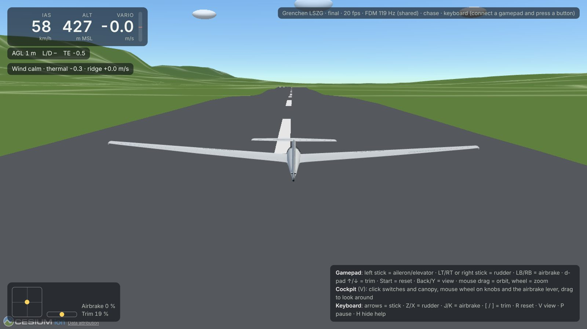
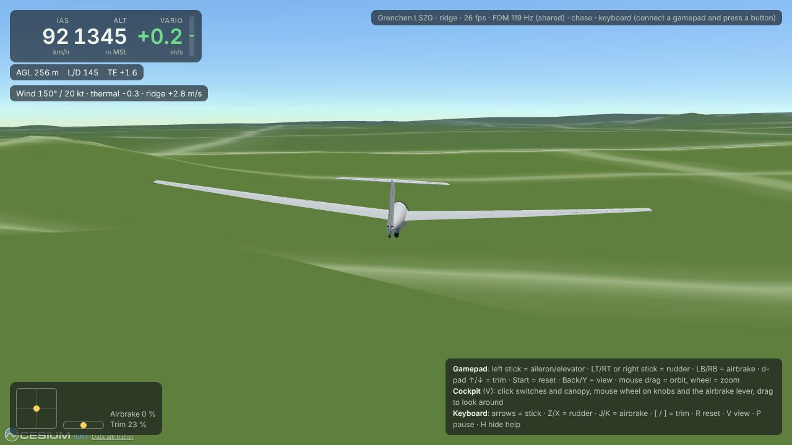

# Milestone 4: real terrain, ridge lift, thermals

```sh
pnpm dev
# http://localhost:5173/                      final for runway 07 at Grenchen (LSZG)
# http://localhost:5173/?start=ridge          Jura SE face, wind 150° / 20 kt
# http://localhost:5173/?start=thermal&columns=1   in a fresh thermal, lift columns drawn
```

| Grenchen, after landing | Ridge soaring the Jura |
|---|---|
|  |  |

## What runs where

| Piece | Where | Notes |
|---|---|---|
| Terrain heights | `environment/terrain.ts` | AWS Terrain Tiles, Terrarium encoding (`R*256 + G + B/256 − 32768`), Web Mercator, zoom 13 (≈ 13 m pixels), bilinear. PNG decoding uses `DecompressionStream`, which works in browsers, workers and Node, so no extra dependency. Public bucket, no key, CORS `*`. |
| Physics terrain | worker / `SoaringSim` | The worker owns the terrain. It loads the start area before trimming, then writes `position/terrain-elevation-asl-ft` every batch and prefetches a 4 km square around the glider. The renderer no longer feeds heights to the FDM. |
| Rendered terrain | `web/scene.ts` | `CustomHeightmapTerrainProvider` on the same tiles and decoder (geographic tiling, 33×33 samples, Terrarium zoom picked per level, zoom 13 from level 15). On the Grenchen runway the drawn ground matches the FDM's to 2 cm. |
| Ridge lift | `environment/ridge.ts` | Port of FlightGear's `FGRidgeLift`: probes 0/250/750/2000 m upwind and 100 m downwind, slope, wind and height factors, low-pass filter, sink in the lee. |
| Thermals | `environment/thermals.ts` | Port of `FGAIThermal`: 30-minute life cycle, `get_strength_fac` profile, column leaning downwind, cosine core, sink ring, −1 ft/s global sink, ground under the thermal re-sampled every 10 s. As in `FGAIManager`, the nearest thermal decides the lift. FG's `rand()` is replaced by a seeded `mulberry32`, so a seed reproduces the sky (needed for training). |
| Into JSBSim | `environment/fdm.ts` | `atmosphere/wind-north/east-fps` from the wind "from" direction, and `atmosphere/wind-down-fps = −(thermal + ridge)`. FG uses the same sum: `/environment/thermal-lift-fps` + `ridge-lift-fps`. Both are also written to the fg-host tree under `/environment/*`. |
| Renderer | `web/scene.ts`, `hud.ts` | Runway at its true heading draped on the terrain, a cumulus at each thermal top (opacity by phase), optional lift columns, and a HUD line with wind, thermal and ridge lift. |

URL parameters:

| Parameter | Values |
|---|---|
| `site` | `grenchen` (default) or `flat`, the old ellipsoid test field |
| `start` | `final`, `ridge` or `thermal` |
| `wind` | e.g. `150@20` (from °, kt). Default 150 at 8 kt, or 20 kt for `ridge`. |
| `thermals` | `0` or `1` |
| `seed` | thermal field seed |
| `columns` | `1` draws the lift columns |
| `dist`, `agl`, `eas` | start distance [m], height above ground [m], speed [km/h] |
| `map` | `osm` for OpenStreetMap imagery |

The thermal start rebuilds the seeded field on the main thread, so it matches the worker's. It picks the strongest thermal within 8 km that formed 5 to 10 minutes ago and starts 60 % of the way up it, a quarter diameter from its leaning centre.

## Results (headless, `apps/headless/test/soaring.test.ts`)

| Scenario | Result |
|---|---|
| ASK21, 700 m down the Jura's SE face, 250 m AGL, along the ridge, 60 s | still air −45 m; wind 150° at 20 kt: ridge lift about 2–4 m/s, **+113 m** |
| Circling at 40° bank in a formed 3 m/s thermal (diameter 600 m), 120 s | **+56 m**; the same thermal dead: −167 m |
| Approach and landing on Grenchen's runway, real terrain | touches down, no bounce, stops; the CG rests at the gear height above Terrarium's 426 m |

On the real Jura at 100 m AGL with 20 kt from 150°, the ridge port gives about +3 m/s on the face and −3 m/s in the lee.

## Findings

- **Datum.** Terrarium heights are above mean sea level. They are used as heights above the WGS84 ellipsoid everywhere: by the FDM, by Cesium, and in `geod-alt-ft`. The geoid separation (about +48 m in Switzerland) is therefore ignored consistently. Altitudes read about 48 m low against true MSL, but the glider and the ground agree.
- **Thermal ground.** If the terrain is not loaded when a thermal is created, its ground height is 0 and its top would sit at cloud base over a fictitious sea-level foot. FG re-samples the ground every 10 s; the port does the same, and lifts the top to at least ground + 600 m.
- **Headless autopilot.** Holding speed directly with the elevator led to a phugoid that diverged. Speed now sets a pitch attitude, which the elevator holds (the same loop as the landing script). FG's rudder sign is "+ = yaw right", which removes positive β. The first version had it backwards, so turns skidded and circled at 5°/s instead of 16°/s.
- **`globe.getHeight` is not a check.** It reads whatever tile level is loaded. In the air, with coarse tiles near the Jura, it can be 100 m off, even though the most detailed tile gives the same heights the FDM uses. Compare on the ground, where Cesium has refined.

## Next

- M5: winch launch and aerotow forces through JSBSim `external_reactions`.
- Wind aloft and turbulence; thermal placement from land use and sun (FG uses random placement as well).
- Imagery: the grid or OSM is a placeholder; aerial imagery needs a provider whose terms allow it.
