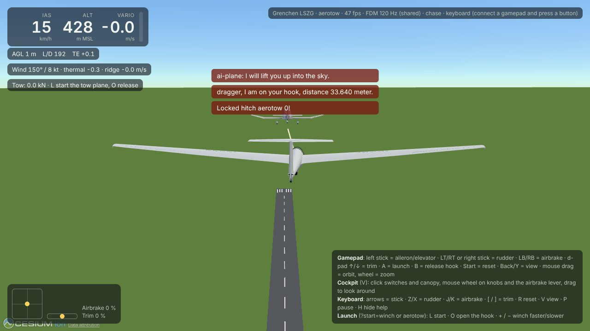
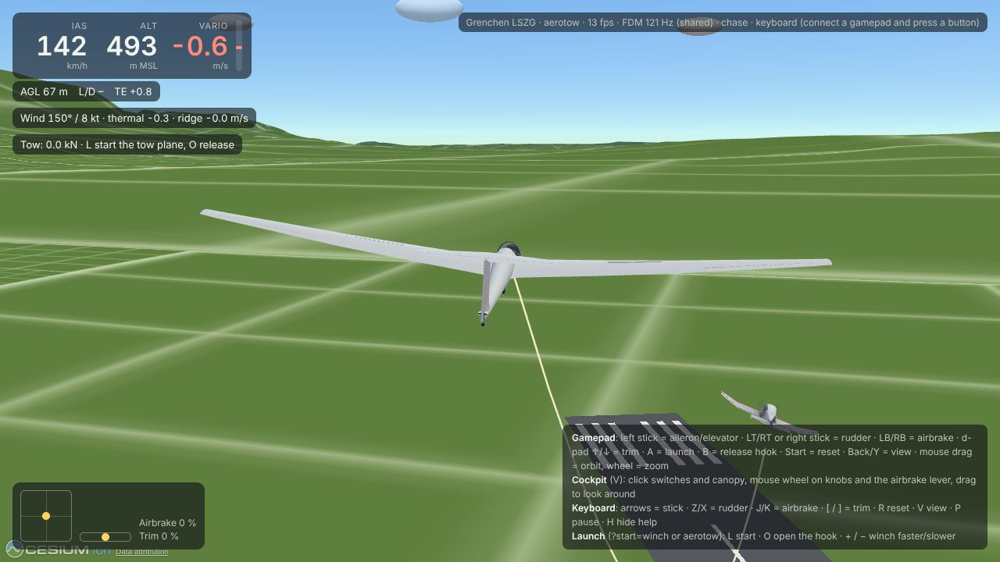

# Milestone 5: winch launch and aerotow

```sh
pnpm bundle:models   # tow plane (FGData AI DR400) and winch (FGData supacat) → apps/web/bundles/_models
pnpm dev
# http://localhost:5173/?start=winch     on runway 07 at Grenchen, 1000 m of cable laid out
# http://localhost:5173/?start=aerotow   behind the tow plane, 60 m rope
```

Keys: **L** starts the launch (clutches the winch, or starts the tow plane). **O** opens the hook. **+ / −** ask the winch driver for more or less speed. On a gamepad, **A** launches and **B** releases. `winchtype=0` selects FG's constant-force winch instead of the default rope-speed winch (type 1).

| On the runway behind the tug | On tow |
|---|---|
|  |  |

## What runs where

FlightGear handles towing for JSBSim aircraft in Nasal: FGData's `Nasal/towing/hitch.nas` for the rope and winch physics, and, for the ASK21, the aircraft's own `Nasal/dragrobot.nas` for a tow plane when there is no multiplayer tug. Both are ported into the browser-free `@webflight/launch` package, so the worker and the headless trainer use the same code.

| Piece | Port of | Notes |
|---|---|---|
| `launch/winch.ts` | `hitch.nas` `winch()`, `auto_winch_driver*`, `setWinchPositionAuto`, `runWinch`, `releaseHitch` | Type 0 (spool to max speed; force from rope stretch, capped by 10 kN and 123 kW). Type 1 (force regulated to reach the driver's rope speed). Driver phases (idle → ready → clear of ground → hold → wind-down). Rope weight. Weak link. Automatic release angle. Tow length limit. Rope-breakage and loss-of-power training (fixed or random height). |
| `launch/aerotow.ts` | `hitch.nas` `aerotow()` (glider as master) | Massless elastic rope, F = k·(d − L)/L (k = 9111 N, L = 60 m). Slack below L. Weak link. Lock range. |
| `launch/tug.ts` | ASK21 `Nasal/dragrobot.nas` | Kinematic tug: placed 0.68·L ahead, tautens the rope, accelerates at 3 m/s² to take off at 20 m/s, climbs proportional to speed (3 m/s at 36 m/s). Then straight legs and random 30–270° turns, drifting with the wind. At +800 m it calls "bye bye", releases 2 s later, and descends in a 45° left turn and departs. FG's `rand()` comes from a seeded generator, so a seed reproduces the tow pattern. |
| `launch/launch.ts` | — | Reads the glider's attitude and hitch from JSBSim and writes the rope force (see below). Aircraft settings come from `/sim/hitches/*` (`hitchesFromProperties`). |
| converter `shared-model.ts`, `sgi.ts` | — | Converts standalone FGData models (AI DR400, supacat winch) to glTF with their animations. SGI `.rgb` textures are decoded and re-encoded as PNG. |
| worker | — | `?start=winch|aerotow`: ground start with the wing runner (FG `/controls/gear/assist-1`, released at 15 kt by the ASK21's ground-handling Nasal). The launch updates before each FDM batch. Its state is published under FG names (`/ai/models/dragger/*`, `/sim/hitches/*`). Messages go to the HUD. |
| renderer `launch-view.ts` | — | Tug and winch models (DR400 propeller animated from its airspeed, winch drums from rope speed) and the rope. The rope sags from its slack but never below the ground. |

### JSBSim interface (verified)

All checked against JSBSim's `src/models/FGExternalForce.cpp` and on the loaded ASK21:

- `external_reactions/<force>/magnitude`: lbs, with the force declared `unit="LBS"`.
- `external_reactions/<force>/x|y|z`: the direction vector in the force's frame. FG's hitches use `frame="BODY"`, whose axes are x nose, y right, z down. A 300 lb push along +x gives `forces/fbx-external-lbs` = 300.
- `external_reactions/<force>/location-{x,y,z}-in`: the hitch in structural coordinates. Together with `inertia/cg-{x,y,z}-in`, this gives the hitch relative to the CG.

The ASK21 declares `winch_hitch` and `aerotow_hitch` forces. Its `-set.xml` and `ask21-main.xml` set the typical winch speed and force (100 km/h, 6000 N), the winch weak link (10 kN), the aerotow weak link (6 kN) and a 70° automatic release.

## Results

Headless (`apps/headless/test/launch.test.ts`): ASK21 solo, Grenchen runway 07, still air. The scripted pilot holds about 105 km/h with pitch on the winch and flies high tow behind the tug.

| Launch | Result |
|---|---|
| Winch type 1 (default) | Airborne after ~7 s. Hook back-releases at 70° at **≈ 355 m AGL after 24 s**. Peak rope force 7.8 kN, peak IAS 143 km/h. |
| Winch type 0 (FG default) | Release at **≈ 350 m AGL**. Peak rope force 9.5 kN, peak IAS 163 km/h, above the ASK21's 150 km/h winch limit. |
| Aerotow, seed 1 | Tug airborne after ~30 s, then a 325 m leg and turns of 31°, 265°, 97°, 203°, 269° and 147°. Released by the tug at **~1040 m AGL after 375 s**. Peak rope force 3.7 kN (weak link 6 kN). |
| Reproducibility | Same seed, same tug track; a different seed, a different one. |

In the browser (`apps/web/scripts/smoke.cjs`), each launch starts with **L** and pulls the glider into the air hands-off. The winch reaches a peak force of 5.2 kN and 170 m; the aerotow pulls 2.5 kN with the tug drawn.

## Findings

- **FG's type-0 winch ignores its driver.** In `hitch.nas`, the automatic winch driver computes a `force_setting` for type 0, but `winch()` never reads it. The drum always spools up to its maximum, so the force is limited only by 10 kN and 123 kW. Type 1 is the type that honours the aircraft's typical tow speed and force, so it is the default here. Type 0 is still available, ported as-is.
- **The ASK21's winch hook is ahead of the CG** (0.7 m ahead, 0.5 m below). As the cable steepens it pitches the nose down, so speed builds towards the top even with full back stick. With the pilot used here, the 70° back-release ends the launch at about 350 m.
- **Ground start ordering.** The ASK21's `groundhandling.nas` drops the wing runner (`assist-1`) whenever the main wheel leaves the ground. If it is set before the glider has settled from its IC height, it is cleared straight away and a wing drops. The worker lets the glider settle for a second before setting it.
- **Placing the winch on the ellipsoid.** FG lays the cable out to `initial-tow-length − 1` m and then refuses to lock if the hook-to-winch distance exceeds the cable length. A spherical-earth step is up to 0.3 % long over 1 km, enough to fail that check, so positions are stepped with WGS84 radii of curvature (≤ 0.1 m error over a kilometre).
- **The aerotow rope has no damping** (in FG either). The glider surges between about 110 and 140 km/h on tow, with the rope going slack and taut.

## Next

- M6: the headless gym API (deterministic seeding, N× real time), with `SoaringSim` and `GroundLaunchSim` as its base. Launches, landings and soaring become environments.
- Winch-cable parachute and pull-in after release (FG's `pull_in_rope`), and a multiplayer or AI tug.
