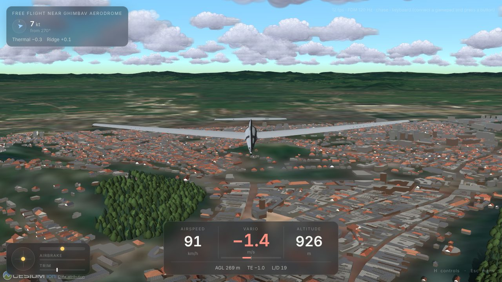

# The world is data

The sim has no hand-made scenarios: a flight is **a place, a time and a launch**. Everything
else comes from data for that place and time, fetched around the start point as needed.

| What | From | Loaded |
|---|---|---|
| Airfields, runway list (designators, length, width, surface) | OurAirports (public domain), `packages/environment/data/airfields/7/x/y.json` | the zoom-7 tile(s) around the start; the search index (`index.json`) only when you search |
| Runway position and heading | OpenStreetMap runway lines (OpenFreeMap tiles), else OurAirports' runway ends, else the designator | zoom-14 tiles around the field |
| Runway in use | the weather's wind: the end with a headwind | — |
| Wind (10 m, 850 hPa, 700 hPa), temperature, dew point, low cloud, sunshine, boundary layer | Open-Meteo for the local hour asked: the forecast API for the last 90 days to 16 days ahead, the historical API (ERA5 / ECMWF IFS reanalysis; surface and 100 m wind, winds aloft extrapolated with a 1/7 power law) for any older day; offline, a sun-based estimate | one request at start |
| Cloud base, thermal tops, strength, spacing, size | the weather: condensation level 125 m × (T − Td), boundary-layer depth, Deardorff w* from the sensible heat flux | — |
| Where thermals are | terrain and sun: sunlit slopes and high ground trigger, shaded slopes don't (`triggerScore`) | per 6 km cell as its terrain tiles arrive |
| Ridge lift | FlightGear's ridge lift from the terrain upwind, anywhere | — |
| Terrain, imagery, water, buildings, trees | Terrarium, orthophotos / Sentinel-2, OpenFreeMap, swisstopo | streamed by view around the aircraft |

## URL

```
?field=RO-0010&at=45.6994,25.5284   airfield (ident + position: the position picks the data tile)
&launch=aerotow|winch               on the runway in use
&time=now|HH:MM|YYYY-MM-DDTHH:MM    local time at the field; the weather of that hour
?lat=…&lon=…&hdg=…&agl=…            or start in the air anywhere (free flight)
```

Overrides for testing: `rwy=04`, `wind=270@15`, `thermals=0`, `seed=N`.

## Rebuilding the airfield data

```
NODE_USE_ENV_PROXY=1 pnpm --filter @webflight/environment airfields
```

## Not data-driven yet

The gym (RL) tasks still use fixed set-ups (Grenchen runway frame, fixed thermals); they
should move to random airfields and recorded weather snapshots (a `Weather` value is plain
data and replays exactly).

## Buildings and trees everywhere

Outside Switzerland, buildings and forest trees come from OpenStreetMap (OpenFreeMap tiles),
meshed in a worker (`osm-worker.ts`) and drawn one primitive per tile (`osm-layer.ts`):
walls on the real footprints, hipped or gabled tile roofs on houses, flat roofs on larger
blocks; low-poly broadleaf and conifer crowns scattered through `landcover=wood`, conifers
commoner with height. Buildings stream in zoom-14 tiles within ±1 tile, trees in zoom-16
cells within ±2 (±3 on ultra) around the aircraft; everything is set on the same terrain
the renderer draws. Brașov from 250 m:


