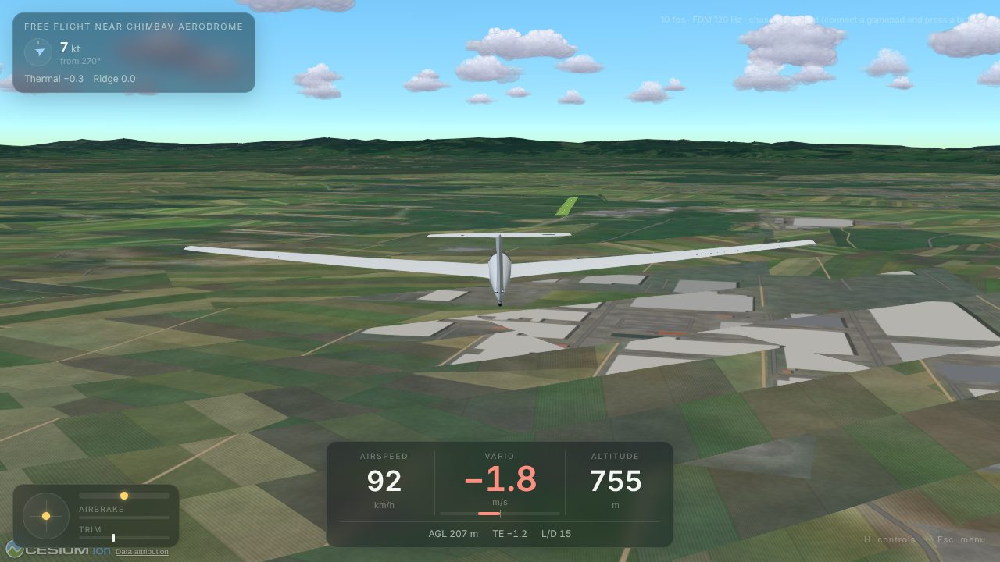

# The world is data

The sim has no hand-made scenarios: a flight is **a place, a time and a launch**. Everything
else comes from data for that place and time, fetched around the start point as needed.

| What | From | Loaded |
|---|---|---|
| Airfields, runway list (designators, length, width, surface) | OurAirports (public domain), `packages/environment/data/airfields/7/x/y.json` | the zoom-7 tile(s) around the start; the search index (`index.json`) only when you search |
| Runway position and heading | OpenStreetMap runway lines (OpenFreeMap tiles), else OurAirports' runway ends, else the designator | zoom-14 tiles around the field |
| Runway in use | the weather's wind: the end with a headwind | — |
| Wind (10 m, 850 hPa, 700 hPa), temperature, dew point, low cloud, sunshine, boundary layer | Open-Meteo for the local hour asked: the forecast API for the last 90 days to 16 days ahead, the historical API (ERA5 / ECMWF IFS reanalysis; surface and 100 m wind, winds aloft extrapolated with a 1/7 power law) for any older day; offline, a sun-based estimate | one request at start |
| Cloud base, thermal tops, strength, spacing, size | the weather: condensation level 125 m × (T − Td), boundary-layer depth, Deardorff w* from the sensible heat flux; each thermal's width skewed round the day's (many narrow, a few wide: lognormal), the wider ones stronger, and the cumulus over it as wide and as tall as its thermal makes it | — |
| Where thermals are | terrain and sun: sunlit slopes and high ground trigger, shaded slopes don't (`triggerScore`) | per 6 km cell as its terrain tiles arrive |
| Ridge lift | FlightGear's ridge lift from the terrain upwind, anywhere | — |
| What you see: ground, buildings, trees, water | Google Photorealistic 3D Tiles via Cesium ion (the default; `google3d.ts`), or with `world=globe` the globe on Terrarium terrain with Bing aerial photos via Cesium ion and OpenFreeMap / swisstopo buildings and trees (`aerial=esri\|google\|s2` for other photos) | streamed by view around the aircraft |
| What the glider flies on | Terrarium terrain heights (the 3D tiles are lowered onto them where the glider is: Google's heights are ellipsoidal, ours above sea level) | tiles around the aircraft |

## URL

```
?field=RO-0010&at=45.6994,25.5284   airfield (ident + position: the position picks the data tile)
&launch=aerotow|winch               on the runway in use
&time=now|HH:MM|YYYY-MM-DDTHH:MM    local time at the field; the weather of that hour
?lat=…&lon=…&hdg=…&agl=…            or start in the air anywhere (free flight)
```

The title screen and every flight run in one page: "Fly", Esc and the browser's back and
forward buttons swap them without reloading (`lifetime.ts` takes away what each added), so the
viewer and Google's 3D tiles carry over, and with them Google's session (Cesium ion meters one
root tile per session of up to three hours). Changing Quality or Scenery reloads the page.

Overrides for testing: `rwy=04`, `wind=270@15`, `thermals=0`, `seed=N`. Scenery: `world=globe`
(the globe with aerial photos instead of Google's 3D tiles), `g3dsse=N` (their detail, default
8), `g3dgrade=0` (their photos as Google has them), `g3dreq=N` (tiles downloading at once).

## Rebuilding the airfield data

```
NODE_USE_ENV_PROXY=1 pnpm --filter @webflight/environment airfields
```

## The gym (RL)

Each episode draws an airfield and runway from the data (OurAirports runways with surveyed
ends, so no network is needed for the geometry) and a weather snapshot by its seed; the
runway in use faces into that wind, and wind, ridge lift and thermals come from the weather
and the terrain (`packages/gym/src/sites.ts`). Terrain is loaded per site and frozen, so
episodes stay bit-reproducible. The tasks keep only their own start set-up (a randomized
final for `landing`, the tug for `aerotow`).

Weather snapshots are recorded from Open-Meteo (historical days included):

```
NODE_USE_ENV_PROXY=1 pnpm --filter @webflight/gym record-weather 500
```

which writes `packages/gym/data/weather-snapshots.json`. Without that file the gym uses the
sun-based estimate with a randomized wind and reports `weather.source = "estimated"` in the
episode info. Tests pin one site with `fixedSite(…)` (Grenchen from the data).

## Buildings and trees everywhere

Outside Switzerland, buildings and forest trees come from OpenStreetMap (OpenFreeMap tiles),
meshed in a worker (`osm-worker.ts`) and drawn one primitive per tile (`osm-layer.ts`):
walls on the real footprints, hipped or gabled tile roofs on houses, flat roofs on larger
blocks; low-poly broadleaf and conifer crowns scattered through `landcover=wood`, conifers
commoner with height. Buildings stream in zoom-14 tiles within ±1 tile, trees in zoom-16
cells within ±2 (±3 on ultra) around the aircraft; everything is set on the same terrain
the renderer draws. Brașov from 250 m:


## Synthesized ground detail (Romania and wherever photos are 10 m)

Where no free orthophotos exist, the only photo layer is Sentinel-2 (10 m pixels), a blur
from a glider at circuit height. A detail imagery layer (zoom 15–18, `detail/`) composes each
tile in workers:

1. the Sentinel-2 image, upsampled edge-aware (each pixel snapped toward the nearer of the
   two dominant colours of its 10 m neighbourhood, so real field edges, forest margins and
   roads become crisp where the data puts them) and levelled;
2. open ground retextured with HD photo textures (Poly Haven, CC0; `textures.ts`): grass
   where the satellite pixel is green, soil where it is brown, a blend in between, dry and
   lush variants in patches. Each texture is a detail map (colour ÷ its mean, in a mip
   pyramid), applied at two scales (true scale for low passes, ×7 so its clumps read as
   meadow and crop texture from altitude), two rotated samples mixed by noise so no repeat
   shows, gain on brightness only so the satellite hue stays. Where the texture is finer than
   a pixel it averages to 1: tiles at every zoom keep the satellite's tone (no bands). Dirt
   tracks, gravel and asphalt get their photos as tone-neutral soft-light overlays up close.
   Forest keeps a procedural canopy with sun shadows. Nothing is invented at the
   scale of fields (an earlier version drew made-up strip fields; they fought the real layout);
3. OpenStreetMap drawn crisp on top: water and waterways, roads (asphalt or dirt from the
   surface tag), railways, rooftops with shadows, runways (surface from OSM, else the
   matching OurAirports runway, else the satellite colour).

It is purely visual; the simulation never reads it. `?detail=0` turns it off;
`detail-preview.html?lat=…&lon=…&z=16` renders tiles for tuning. In Romania, ANCPI's
orthophotos are layered on top when the geoportal answers (it is discovered at runtime; it
did not answer from outside Romania).

From the glider at 220 m:



## Close range (MSFS-style)

- **Grass**: 3D blades near the camera (`grass/`): tufts where the ground is grass (green in
  Sentinel-2, not a road, paved runway, building, water or forest in OSM), short mown grass on
  grass strips and in aerodromes, coloured from the satellite, densest at the camera and
  dithered out with distance, swaying in the wind. High 45 m, Ultra 70 m.
- **Ground** under it: the HD textures at true scale, detail tiles down to zoom 21.
- **Trees**: impostors (`tree-impostors.ts`): photoscanned CC0 trees (Poly Haven) rendered
  offline from the side and from above into one atlas; each tree is a side card turning to the
  camera plus a top card, cross-faded by view angle, lit by the sim's sun, swaying. Placed in
  OSM forests (conifers commoner with height), denser near the camera and sparser outwards.
- **Buildings**: the OSM meshes carry texture coordinates and a material per vertex; the
  shader multiplies each building's own colour by a photo detail map (plaster, clay tiles,
  bitumen; mipmapped and repeating, the photo detail eases out by 260 m) and draws windows from
  the wall coordinates.
- **Relief and colour up close**: the ground textures' height maps give each sample a slope;
  the detail tiles shade it by the sun (a slope rising towards the sun is darker), at true
  scale and in the ×16 layer, so grass and soil have lit and shaded sides instead of a flat
  print. Below 2 m per pixel the satellite's dark average eases towards the colours grass
  and soil have at arm's length (the 3D blades use the same). Building walls and roofs are
  embossed from their photos, and windows are recessed (lintel and reveal shadow, sill).
- **Town ground** (built-up land in OSM, and yards round buildings): below ~5 m per pixel the
  10 m satellite smear gives way to lawns (grass texture, trodden patches) and paving
  (asphalt at half contrast, in the local satellite tone), split by a crisp, irregular edge
  where the satellite is green; streets in town get sidewalks (slab joints up close) and a
  curb, buildings a concrete apron. Zoom 14 stays plain so tiles still meet Sentinel-2.
- **Detail tiles on the GPU**: the per-pixel work of a detail tile (edge-aware upsampling,
  HD textures, relief, town ground, canopy) runs as a fragment shader in the tile worker's
  own WebGL 2 context (`detail/gpu-synth.ts`); the 2D canvas then draws roads, buildings and
  the night look on top as before. The CPU code (`synth.ts`) is the reference and the
  fallback (`?detailgpu=0`, no WebGL 2 in workers, lost context). Both give the same tile:
  mean difference 0.003–0.05 of 255 over fields, town, forest and zooms 15–20; at most 0.03%
  of pixels differ by more than 8 (hard lawn/paving edges that fall the other way).
- **Facades** are generated in the shader from each wall's coordinates, its building's wall
  height and a style seed: houses get a plinth, floor bands, recessed windows with frames and
  sills, shutters on some, doors on the ground floor and an eave shadow; blocks get precast
  panel joints or banded plaster and shop fronts; all get a contact shadow, grime under the
  sills and rain streaks. Flat roofs: bitumen membrane (with seams) or gravel, two rotated
  samples mixed by noise and large stains, a parapet with coping, and metal rooftop units.
- **Variety**: window pitch (houses 2.3–3.6 m, blocks 2.7–3.6 m), window size, storey height
  and frame colour vary per building; per window, roller shutters part or all the way down,
  curtains, and the sky reflected in the glass. Beyond ~200 m windows fade into the facade's
  average tone instead of speckling. The style seed is a multiple of 1/512 so the shader
  recovers it exactly (hashing an interpolated value gives per-pixel noise).
- **Wall finishes from OSM**: OpenMapTiles turns `building:material` into a colour; brick
  (`#bd8161`) gets a brick photo with soldier-course lintels, glass (`#5a81a0`) a curtain wall
  with mullions and spandrels, other `building:colour`s tint the plaster. Untagged buildings
  are plaster, or brick where brick is common (40% north of 50.5° N, else 6%). Outlines with
  `hide_3d` are skipped (their parts are drawn).
- **Balconies** are real geometry on blocks (walls over 13 m, 2.8 m storeys): boxes on every
  storey above the ground floor in columns aligned with the windows (every 2–4 columns, one or
  two wide, per building), open (slab and a 1.05 m front with a handrail) or glazed in to the
  slab above, as owners do in Romanian blocks; at most 400 per building. They cast shadows.
